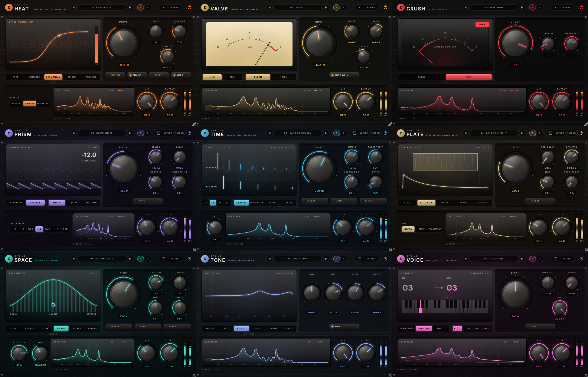

# Epsilon Expansion 0.3

Nine creative effects with their own sound and look. Each one has the same set of controls and behaviours as a well-known studio effect. The DSP, names and graphics are all original.

| Plugin | What it does | Reference behaviour |
|---|---|---|
| **Epsilon Heat** | Five-style analog saturation | multi-style saturator with Punish, Thump and Steep |
| **Epsilon Valve** | Twin-stage tube preamp | dual tube preamp/EQ with a Mic/Line input |
| **Epsilon Crush** | Level destroyer | aggressive level-locking compressor |
| **Epsilon Prism** | Pitched splice echo | granular reverse/pitch echo |
| **Epsilon Time** | Dual variable-clock delay | dual delay with a variable clock and Freeze |
| **Epsilon Plate** | Electro-mechanical plate | five-model plate reverb |
| **Epsilon Space** | Shaped time tunnels | shaped multi-tap delay/reverb |
| **Epsilon Tone** | Broadcast console EQ | three-band console EQ with an amp stage |
| **Epsilon Voice** | Pitch, formant and robot | pitch/formant voice shifter with Quantize and Robot |



## Build it (Projucer, the way you're used to)

1. Open a plugin folder, for example `EpsilonHeat/`, and double-click **`EpsilonHeat.jucer`**.
2. In Projucer click **Save and Open in IDE** (Xcode).
3. In Xcode pick the scheme **`Epsilon Heat - All`**, choose **Release** and build.
   You get VST3, AU and Standalone. JUCE copies the plugins to `~/Library/Audio/Plug-Ins`.

Everything is included. `JUCE/` holds the JUCE 9.0.5 modules and `Source/` holds the shared code. The target is macOS 12.0 or later, built for both Apple Silicon and Intel.
Each plugin has its own folder because Projucer creates one `JuceLibraryCode` folder per project.

### Automatic builds (GitHub)
When this repo is on GitHub, `.github/workflows/build.yml` builds all nine on a Mac for every push and runs **pluginval**. The downloads are under *Actions → latest run → Artifacts*.

## Controls

The Tweak button opens the advanced controls (on Prism, Time and Plate).

* **Inspire**: loads a random factory preset.
* **A / B**: lets you compare two settings.
* **Power button**: bypass. It keeps the latency the same, so there are no clicks or timing shifts.
* **Hover any control** for a tooltip that explains it.

Every plugin has Mix and Output, IN/OUT meters and a live input/output spectrum. Each also has 12 factory presets. The window can be resized from 70% to 200%.

* **Heat**
  * **Drive**, plus **Style**: Tape, Console, Germanium, Triode or Pentode.
  * **Tone tilt** before the saturation.
  * **Low Cut** with **Thump** (a resonant bump at the cutoff).
  * **High Cut** with **Steep** (6 or 30 dB/oct).
  * **Punish** (+20 dB) and **Auto** gain.
  * **Quality**: 2×, 4× or 8× oversampling.
* **Valve**
  * **Input** drives the first tube stage.
  * **Line/Mic** source and **Noisy/Clean**.
  * **Bass** and **Treble** at ±10 dB.
  * **Drive** for the second stage.
  * **Auto Gain** and a cream VU "heat" meter.
* **Crush**
  * **Crush** sets how hard it hits the limiter. Attack is about 1.3 ms. Release is Slow (about 1.7 s) or Fast (about 0.85 s) and stretches up to about 13× when you drive it hard.
  * **Crunch** and **Darkness**.
  * A gain-reduction needle with a **LOCK** lamp.
* **Prism**
  * **Pitch** ±24 st, **Splice**, **Delay**, **Recycle** and **Smoothing**.
  * **Forward/Reverse**, plus feedback mode **Mixed/Dual/Ping-Pong**.
  * **Sync** to note values.
  * Tweak: Gate/Duck, Threshold, Spread, Offset, Low/High Cut.
* **Time**
  * Two lines (**Time**, **Feedback**, **Level**).
  * **Multiply** 1×, 2×, 4× or 8×. This lengthens the delay and narrows the bandwidth by the same factor (12k/6k/3k/1.5k).
  * Modes: **Classic**, **Ping-Pong**, **Series**, **Cross**.
  * **Freeze**, **Sync** and **Link**.
  * LFO **Depth/Rate/Shape**.
* **Plate**
  * Five plate models: Steel, Gold Foil, Bright, Warm, Splash.
  * **Decay** (RT60 at 500 Hz), **Pre-Delay**, **Damping**, **Mod**, **Auto-Decay** (ducking) and **Freeze**.
  * **Amp**: Clean, Tube or Transistor.
  * Tweak: Low/High Cut, Width, Mod Rate.
* **Space**
  * **Time** from 0.1 to 60 s, or synced from 1 beat to 8 bars.
  * **Shape** (decay → bloom → reverse) and **Contour**. You can also drag the point on the display.
  * **Texture** (discrete → diffuse), **Color** (tilt over time), **Mod**.
  * **Warp** (tape-style time changes) and **Freeze**.
* **Tone**
  * **Low** ±15 dB (a shelf when cutting, a bell when boosting).
  * **Mid** ±8 dB at 700 Hz, 1k, 1.5k, 2.3k, 3.5k or 5.6k, with proportional Q.
  * **High** ±15 dB.
  * **Drive** into an amp stage with automatic gain.
* **Voice**
  * **Pitch** ±12 and **Formant**.
  * **Link**: formants follow the pitch.
  * Modes: **Transpose**, **Quantize** (snaps to the nearest semitone) or **Robot** (holds one note).
  * **Drive** and **Tone**.
  * Voice range: Auto, Low, Mid or High.

## What changed in 0.3: Voice rebuilt for low latency and low CPU
In 0.2, Voice used a general-purpose phase-vocoder shifter with a 2048-sample analysis block. That meant about 46-50 ms of latency and 18-30% of a CPU core, too slow to sing through.

A voice is monophonic and periodic, so 0.3 uses **TD-PSOLA** (pitch-synchronous overlap-add), the classic real-time voice method:
- A YIN tracker finds the period.
- Two-period grains are cut one period apart and laid down again at the new period.
- Each grain keeps the vocal tract's resonances, so formants stay put on their own. Reading a grain faster or slower moves them on purpose (Formant knob, or Link).
- Grains are read while they play, so the look-ahead only has to cover about half a period.
- Quantize and Robot set the output period straight from the target note. Robot is dead flat and Quantize lands exactly on the semitone.

| | 0.2 | 0.3 |
|---|---|---|
| Latency | 46.4 ms (48 kHz), 50.5 ms (44.1 kHz) | **11.1 ms** |
| CPU, 48 kHz, one instance | about 18% of a core | **about 3.7%** |
| Voice quality checks (`Tests/voice_quality.cpp`, 3 sample rates) | 33 pass / 27 fail | **59 / 59 pass** |

The pitch tracker's difference function is updated one sample at a time, instead of being recomputed every 4 ms. The tube Drive stage is switched out (with a matching delay and a 20 ms cross-fade) when Drive is at 0 dB.

**Editors draw faster.** The faceplate is cached at the screen's real pixel density. Before, it was re-scaled for Retina on every repaint, which was the biggest cost of every frame and also made it slightly soft.

## 0.3: lag fixes (measured on Intel and Apple Silicon Macs)
`.github/workflows/perf.yml` measures Voice latency and CPU per audio block, and the editors' drawing cost, on GitHub's Intel Mac (same chip generation as a 2019 MacBook Pro) and on Apple Silicon. The results are in each run's Summary.
* **Voice latency went from 46 ms to 11 ms.** The general-purpose phase vocoder is replaced by a pitch-synchronous (TD-PSOLA) shifter driven by the YIN pitch tracker, with formants moved by resampling each grain. CPU is about 1% of a core on Apple Silicon, and 59 quality checks pass (`Tests/voice_quality.cpp`).
* **Editors redraw only what moves.**
  * macOS merges a window's dirty areas into one rectangle, so updating the display and the meters made JUCE repaint every knob between them, 30 times a second.
  * The editor now draws through a software-rendered cache that re-renders only the areas that actually changed, one by one. The system then shows the result as a single bitmap.
  * The VU and gain-reduction meter faces are cached, and only the needle is drawn each frame. A resting needle doesn't redraw at all.
  * Measured drawing cost per frame dropped by about 50–70% on every plugin.

## What changed from 0.1 (test findings fixed)

| Area | 0.1 finding | 0.2 |
|---|---|---|
| Heat / Tone | −5.6 dB at 16 kHz with nothing engaged; 2 dB comb filtering at 50% mix | New halfband oversampler with integer latency, flat to 20 kHz; dry path aligned |
| Heat styles | Three styles sounded almost the same (odd harmonics only) | Five distinct curves with pre/de-emphasis, even and odd harmonic balance, Punish, Thump, Steep |
| Time | ×8 gave no echo; only one time control | True variable clock with 12-bit storage, two lines, four modes, Freeze, LFO |
| Plate | Metallic ringing 37–57 dB, sparse early tail, RT60 about 10% short | Plate tank plus a dispersion network, calibrated RT60, five models |
| Space | Feedback network about 15% short; not a tap swarm | 64-tap shaped swarm, Shape/Contour, Texture, Color, Warp, Freeze |
| Prism | Pitch 9–37 cents off | Pitch now accurate within a few cents (YIN-measured) |
| Tone | Wrong mid frequencies and drive range | 700 Hz to 5.6 kHz mids, proportional Q, Drive −15 to +15 dB |
| Voice | No Quantize, Robot or Link | All three added (YIN tracker plus a low-latency PSOLA shifter) |
| Hosts | Switches could restore half-way (pluginval strictness 8) | Stepped, discrete parameters snap exactly |
| Packaging | Nine .jucer files in one folder shared one JuceLibraryCode; Intel-only | One folder per plugin, Universal, JUCE 9.0.5 bundled |

### Remaining limits
* At 44.1 kHz the plate tails ring 16–19 dB above the tail median. That is much better than 0.1 (22–40 dB) but above ideal diffuse noise (about 11–12 dB).
* With Heat at 4× and an extreme high-frequency test tone, aliasing is about −45 dBc. Ultra (8×) brings it down to about −78 dBc.

## Tests

`Tests/suite.cpp` runs 94 checks across all nine effects, including frequency response, harmonics, RT60, pitch accuracy, latency, bypass, NaN/denormal safety and CPU. It needs no JUCE.

```
clang++ -O3 -std=c++17 -march=haswell -ISource Tests/suite.cpp -o suite && ./suite        # 48 kHz
./suite 44100 && ./suite 96000
clang++ -O3 -std=c++17 -march=haswell -ISource Tests/fuzz.cpp -o fuzz && ./fuzz          # automation fuzz, no NaN
```

`Tests/ui_snapshot.cpp` renders all nine editors to PNG. Build it with CMake: `-DJUCE_PATH=<full JUCE 9> -DEPSILON_UI_TESTS=ON`.

## Licences
* **JUCE 9.0.5** is dual-licensed under AGPLv3 or a commercial JUCE licence. If you sell these plugins closed-source, you need a commercial JUCE licence. See `JUCE/LICENSE.md`.
* The **Epsilon Dial** typeface (`Shared/epsilon_ui/EpsilonDialFont.h`) is proprietary to Epsilon Sounds.
* The product names, panels and DSP are original. No third-party trademarks, logos or graphics are used.
